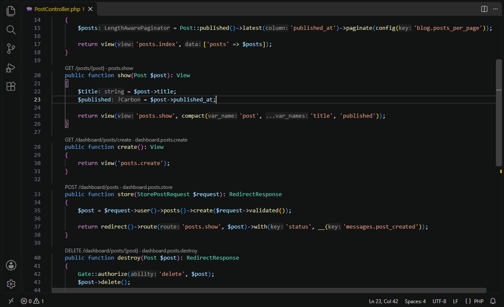
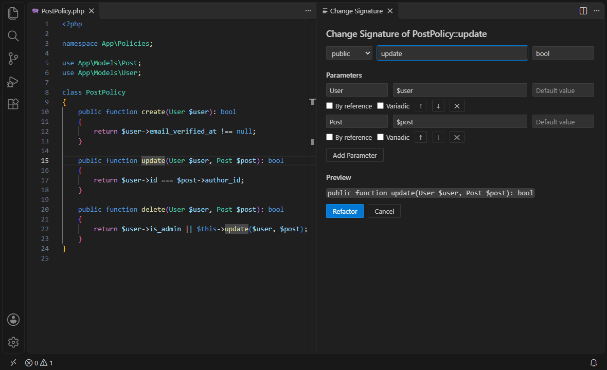

# Phoxite for VS Code

PHP and Laravel code intelligence from a native engine written in Rust: no PHP, Node.js or
licence needed for any feature.

## Quick start

1. Install the extension and open a folder with PHP in it. The server is part of the
   extension: there is nothing else to install or configure.
2. Open a PHP or Blade file. **Phoxite** in the language status (the `{}` in the status
   bar) shows the project being read, then says **Phoxite**, or **Phoxite: Laravel** in a
   Laravel project.
3. If Intelephense or another PHP language server is enabled, disable it for the
   workspace: see [Other PHP extensions](#other-php-extensions).

**Requirements.** VS Code 1.85 or newer, on Windows, macOS or Linux (x64 and arm64;
Alpine x64). PHP itself is needed for two things only, both optional: running Artisan
commands, and PHPStan or Psalm on save.

## PHP

- Completion with auto-import, named arguments, array keys and enum cases
- Hover, signature help, inlay hints (parameter names, types), semantic highlighting
- Go to Definition, Type Definition and Implementation; Find All References; call and type
  hierarchies; workspace symbols
- Rename (a class's file is renamed with it); moving files updates namespaces and references
- Quick-fixes and refactorings, Organize Imports, Format Document (PSR-12)
- Inspections: undefined classes, functions, methods and properties, type mismatches, unused
  imports and more, each one configurable (`phoxite.inspections`)
- PHPStan and Psalm on save, when the project installs them (`phoxite.analyzers.onSave`)

### Refactorings that ask first

- **Change Signature…** (the lightbulb on a function or method, the Command Palette, or
  **PHP Refactorings** in the editor's context menu) opens a form: rename it, change its
  visibility and return type, and add, remove, reorder and retype its parameters. Calls,
  overrides and implementations are updated; a new parameter can name the value existing
  calls pass.
- **Extract method…** / **Extract function…** on a selection asks for the name, the
  visibility, which variables to pass, whether it is static, and whether to replace the
  duplicates of the code.
- **Generate getters…**, **setters…**, **constructor…**, **Override methods…** and the other
  Source Actions ending in `…` let you tick the members first.
- **Pull Members Up…** and **Push Members Down…** move methods, properties and constants
  between a class and its parents or subclasses, list what would break and ask before
  going on.

## Laravel

- Routes, views, Blade components, config, env, translations, validation rules, gates and
  policies, Artisan commands, Livewire, Inertia, macros and modules: completion, go to
  definition, hover, usages and rename for the strings that name them
- Eloquent: columns from the migrations, relations, scopes, factories; with
  `phoxite.laravel.database`, also the columns the project's SQLite database really has
- Code lenses on controller methods with their routes, the full URI after each route
- Laravel inspections with quick-fixes (create a missing view, translation key…)

### Laravel tools

The commands below are in the Command Palette under **Laravel** once a Laravel project is open.

- **Laravel Routes** (Explorer view) lists the routes by route file: click one to go to it,
  or copy its URL, open it in the browser or copy it as an HTTP request. **Go to Route…**
  searches them by method, URI, name or action.
- **Model view**: the lens on an Eloquent model class opens the model's table, columns,
  relations, scopes, accessors and related classes (factory, policy, migrations…). Each
  item goes to its declaration; right-click for Find Usages and Rename. **Add Columns…**
  writes a migration and adds the columns to `$fillable`.
  
- **Generate…** (also in the Explorer's context menu) creates controllers, Form Requests,
  migrations, jobs, mailables, policies, Blade components, tests and more, plus the code
  generations of the project's `ide.json`. **New Eloquent Model…** is a form for a model
  with its fields (an enum with its values, a foreign key with what deleting does, the
  columns of a polymorphic relation), relations (through another model and polymorphic
  ones too) and indexes, and optionally its migration, factory, seeder,
  controller, Form Requests, JSON resource and policy.
- **Run Artisan Command…** lists the project's commands, Laravel's and the packages', asks
  for arguments and runs the command in the terminal. A console command class has a
  **Run artisan …** lens. The project's own commands are also in **Tasks: Run Task**, and
  `tasks.json` can keep one with its arguments:
  `{ "type": "artisan", "command": "migrate", "arguments": "--seed" }`.
  **Run Last Artisan Command** repeats the last one with its arguments. Commands run
  as `phoxite.laravel.artisanCommand` says (`php artisan` by default); in a project set
  up for Laravel Sail the extension asks once whether to run them through Sail.
- **Create translation key…** (the lightbulb on a translation key some locale lacks) asks
  which locales get the key and their texts.
- **Edit Generator Template…** opens the project's copy of a generator's template
  (`.phoxite/templates/<name>.ft`); the generators use it instead of the default.

## Blade

Completion, hover, go to definition and usages inside echoes, directives and `@php` blocks;
directive, section, stack and component names; the template's own problems; formatting.

Highlighting covers Blade wherever it is written: in the text, inside HTML tags and
attribute values (`<a href="{{ route('home') }}">`, `@class([...])`), in a component's
bound attributes (`:type="$type"`) and in scripts and styles. Type `@` for snippets of
the directives (`@if`, `@foreach`, `@section`…), or `x-` for a component tag.

## Settings

| Setting | |
| --- | --- |
| `phoxite.phpVersion` | The PHP version; empty: from `composer.json`. |
| `phoxite.includePaths` | Folders and single files outside the project to index (`../shared`, `../../config.php`). |
| `phoxite.stubs` | Extra extension stubs (`redis`, `swoole`…). |
| `phoxite.exclude` | Globs left out of the index. |
| `phoxite.inspections` | Per-inspection `enabled`, `strict` and `severity`. |
| `phoxite.laravel.*` | Detection, route hints, modules, Inertia page folders. |
| `phoxite.laravel.database` | A SQLite database to read columns from: `auto` (the one in `.env`) or a path. Empty: the migrations alone. |
| `phoxite.laravel.artisanCommand` | How Artisan runs: `php artisan`, `./vendor/bin/sail artisan`… |
| `phoxite.laravel.generation.*` | What the generators write: namespace, module, class suffixes, constructor promotion, return types. |
| `phoxite.templates.path` | The folder of edited generator templates. |
| `phoxite.format.lineWidth` | The line length for Format Document. |
| `phoxite.format.tool` | `phoxite` (the built-in PSR-12 formatter) or `pint`: the project's Laravel Pint formats whole PHP files. |
| `phoxite.analyzers.onSave` | Run the project's PHPStan and Psalm on each saved PHP file. |
| `phoxite.analyzers.phpPath` | The PHP interpreter that runs them; empty: `php` on `PATH`. |
| `phoxite.server.path` | Use another `phoxite-lsp` binary (`~` and a path relative to the workspace folder work). |
| `phoxite.server.logLevel` | How much the server writes to its log. |
| `phoxite.trace.server` | Log what the extension and the server say to each other. |
| `phoxite.warnAboutOtherServers` | Warn about extensions that answer the same requests. |

A project can carry the settings about its code itself: a `phoxite.json` at its root
holds them without the `phoxite.` prefix (`{ "phpVersion": "8.4", "stubs": ["redis"] }`),
with completion and validation as you type. What it sets wins over the settings above,
for everyone who opens the project, in any editor. It can't set `analyzers.*` or
`laravel.database`, and `includePaths` is read from it only in a trusted workspace.

## Several projects in one workspace

In a multi-root workspace each Laravel folder is its own project. A command is about the
project of the active editor (the first Laravel project when the editor is elsewhere);
a model view or a form stays with the project it was opened for. The routes view lists
the routes under their project, and Run Task offers each project's Artisan commands.

## When something is wrong

The **Phoxite** entry in the language status (the `{}` in the status bar of a PHP or
Blade file) says what the server is doing: starting, indexing, ready, or not running,
and whether the project is a Laravel one. Click it for **Restart the Language Server**,
**Show the Server Log** and **Index the Project Again**; the same commands are in the
Command Palette under **Phoxite**.

- **Nothing completes, or "the language server is not running".** Open the log (**Show
  the Server Log**): it says why the server didn't start. If `phoxite.server.path` is
  set, it has to name a `phoxite-lsp` that exists; empty uses the bundled one.
- **A class or a route that exists is reported missing.** **Index the Project Again**
  reads every file anew. Code outside the workspace folder is found through
  `phoxite.includePaths`, which takes folders and single files: each folder is indexed whole, and when it has a `composer.json`
  (or is the `vendor` folder of a project that has one), the folders that file autoloads
  are indexed too. After changing a `composer.json` outside the workspace, run **Index
  the Project Again**: the editor only reports changes inside it.
- **Completions and problems show twice.** Another PHP extension answers too: see below.
- **Laravel features are missing.** The status says **Phoxite: Laravel** when the folder
  is recognised as one (`composer.json` requires `laravel/framework`, the lock file lists
  it, or an `artisan` file exists); `phoxite.laravel.detection` can force it.
- **To report a problem**, set `phoxite.server.logLevel` to `debug`, restart the server,
  reproduce it, and attach the log to an
  [issue](https://github.com/samehelhawary/phoxite/issues).

## Other PHP extensions

Disable Intelephense or other PHP language servers in the workspaces where you use this
extension: both would answer every request, so completions and problems show twice. The
extension says so when it finds one (also for Laravel extensions that complete the same
names, and for ones that define the Blade language too), once per workspace.

## Restricted Mode

In a workspace you haven't trusted, Phoxite still gives code intelligence, from the
files it reads. It runs nothing of the project there: Artisan, PHPStan, Psalm and Pint stay
off, and the settings that name a program or a file outside the project
(`phoxite.server.path`, `phoxite.analyzers.phpPath`, `phoxite.laravel.artisanCommand`,
`phoxite.laravel.database`, `phoxite.includePaths`) are read from your own settings
only, not from the workspace's.

## Licence

Apache-2.0. It bundles JetBrains phpstorm-stubs (Apache-2.0). Not affiliated with
JetBrains or Laravel.
